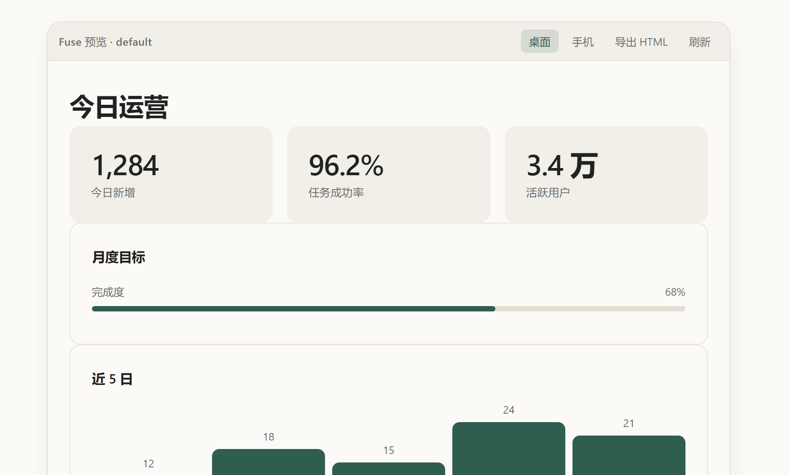

# dsh-fuse

> 对话里写一段 JSON，就长出一页能点的界面；看完可以导成 HTML 带走。

**v2.0.5** · MIT License · DSH 0.2.x（`>=0.2.0-rc.2 <0.3.0-0`，0.2.1-rc.3 桌面版实测）· Node `^22.19.0` 或 `>=24.0.0`

---



上面这张图**不是画的**：它就是下面那段 JSON 交给渲染器之后的输出（`tests/make-preview.mjs` 生成独立 HTML，再用无头浏览器截图），所以和你在对话里看到的完全一致。

---

## 它做什么

在回答正文里写一个 `dsh-fuse` 代码围栏，围栏内容是 JSON 规格；宿主把"规格长什么样"注入系统提示词，浏览器端把规格渲染成真页面——卡片直接出现在对话里，工具条上可以导出成单页 HTML、切换桌面/手机宽度。

## 能力

- **围栏渲染**：10 种页面类型——`login_form` / `signup_form` / `dashboard` / `settings_page` / `table_page` / `landing_page` / `profile_card` / `pricing_page` / `modal` / `form`
- **三态兜底**：流式生成中显示骨架屏；规格非法显示错误卡（原因 + 原始 JSON 折叠）；正常则渲染
- **导出 HTML**：工具条「导出 HTML」下载自包含单页，无外链、无运行时依赖
- **宽度切换**：桌面 / 手机（420px）两档
- **交互回传**：带 `action` 的 button/input/select/textarea/checkbox/radio 点击后以 `[fuse-action] 名字` 回传会话
- **主题令牌**：`config/theme.json` 三套主题——`default`（松绿 + 陶土 + 纸白）、`apple`（中性灰 + 墨绿）、`dark`（暖石墨 + 鼠尾草绿 + 琥珀）；3 色 + 中性色，4/8 栅格，字号 12/14/16/20/28/36/48

## 规格

```json
{"type":"dashboard","title":"今日运营","theme":"default","components":[
  {"type":"row","components":[
    {"type":"stat","value":"1,284","label":"今日新增"},
    {"type":"stat","value":"96.2%","label":"任务成功率"}
  ]},
  {"type":"card","title":"月度目标","components":[
    {"type":"progress","label":"完成度","value":68,"max":100}
  ]},
  {"type":"card","title":"近 5 日","components":[
    {"type":"chart","kind":"bars","data":[{"label":"一","value":12},{"label":"二","value":18}]}
  ]}
]}
```

> 上面这张预览图对应的就是这段 JSON。容器（`row` / `card` / `grid` / …）里写子节点时，**`components` 和 `items` 都认**。

| 字段 | 必填 | 说明 |
|---|---|---|
| `type` | 是 | 根节点必须是上面 10 种页面类型之一 |
| `title` | 否 | 页面标题 |
| `theme` | 否 | `default` / `apple` / `dark`，缺省 `default` |
| `components` | 是 | 组件树，容器类型（`page`/`card`/`grid`/`row`/`col`/`section`/`form`）可递归嵌套 |
| `context` | 否 | `{product, audience, task}`，用于适配语气 |
| `actions` | 否 | 底部主操作条 `[{action,label,tone}]`，每页一个主操作 |

**预算**：组件总数（含嵌套）≤ 60，嵌套深度 ≤ 8；超限整份拒绝渲染并显示错误卡（不静默截断）。

**组件白名单**（34 个，只认这些）：
`page card grid row col nav header footer section tabs hero text badge stat list table divider avatar chart steps loading skeleton progress alert timeline code form input select textarea checkbox radio button link`

## 安装

```bash
npm pack                     # 产出 dsh-fuse-2.0.4.tgz
dsh plugin --profile desktop add --offline file:<你的路径>/dsh-fuse-2.0.4.tgz
```

- 改完 JS 必须**重打包 + 重装 + 重启 DSH**（ESM 模块缓存，热更不生效）。
- 卸载：`dsh plugin --profile desktop remove dsh-fuse`（注意这会连 profile 的 `bundles` 条目一起删掉，重装后要确认包名还在数组里）。

## 结构

| 文件 | 职责 |
|---|---|
| `index.mjs`（73 行） | 宿主半区：注册系统指令段（order 106）+ `ctx.inject(['webServer'])` 懒注入 `GET /api/fuse/config` |
| `spec.mjs`（61 行） | 页面类型 / 组件白名单 / 容器类型 / 预算 / 系统指令正文；`summarizeTheme()` 把令牌压成模型可见的紧凑文本 |
| `lib/client.js`（967 行） | 浏览器半区：单文件零依赖渲染器（校验 → 解析 → 渲染 → 导出 → 宽度 → DOM 回传） |
| `config/theme.json` | 设计令牌（brand + themes） |
| `locale/zh.json`、`locale/en.json` | 插件卡片文案（标题「页面渲染」） |
| `tests/all.mjs` + `tests/run.mjs` | 7 项测试，含「词汇表同步」——浏览器端白名单与 `spec.mjs` 必须字面一致 |
| `cordis.patch.yml` | bundle 挂载声明 |

## 与 v1 的差异

v1 有走查器（Inspector）、撤销快照、设置页、代码规范注入（`code-style.json`）、`validate_fuse_spec` 预检工具、spec-validator 生成区间机制，以及双语 README。

v2 全部删掉：这些都是「微调 / 平台化」能力，不是渲染本身。`lib/client.js` 1609 → 967 行，每次请求注入的提示词也少两段。

## 测试

```bash
npm test        # node tests/all.mjs（8 项）
```

CI（GitHub Actions）：Node 22.x / 24.x 矩阵 → `npm install` → `npm test` → `npm pack --dry-run`。

## 预览图怎么来的

```bash
node tests/make-preview.mjs     # 用真实渲染器把示例规格渲成 docs/preview.html
# 再用无头浏览器截图（本机 CentBrowser / Edge 均可）：
# chrome --headless=new --force-device-scale-factor=2 --window-size=880,820 \
#        --screenshot=docs/preview.png file:///<绝对路径>/docs/preview.html
```

图里的内容 = 示例规格的真实输出，改了渲染器就重跑一遍，不要手绘。

## 版本历史

| 版本 | 日期 | 说明 |
|---|---|---|
| **v2.0.5** | 2026-10-25 | **修渲染 bug**：容器（`row`/`grid`/`col`/`card`/`section`/`form`）过去只认 `items`，用 `components` 写的嵌套会被校验放行、渲染成空壳；现在两者都认。补「嵌套组件」回归测试（8 项）+ README 预览图 |
| v2.0.4 | 2026-10-25 | 插件卡片文案改走 `locale`（标题「页面渲染」），`description` 改成一句英文；功能无变更 |
| v2.0.0 – v2.0.3 | 2026-10-25 | 收敛为单一职责：删走查器 / 撤销 / 设置页 / 预检工具，重写渲染器与测试，新增 `spec.mjs`、`tests/all.mjs` |
| v1.x | 2026-09 及更早 | 旧版（含走查器与设置页），已冻结不再维护 |

## 边界

- **只渲染**：不做设置页、不做走查器、不做预检工具、不做平台化。
- 渲染宽度跟随 composer；全屏模式不撑满。
- 规格非法时整份拒绝并展示错误卡，不猜测意图做降级渲染。
